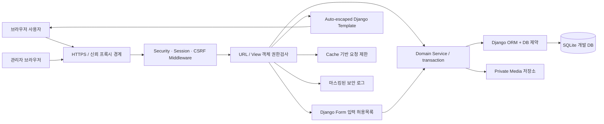
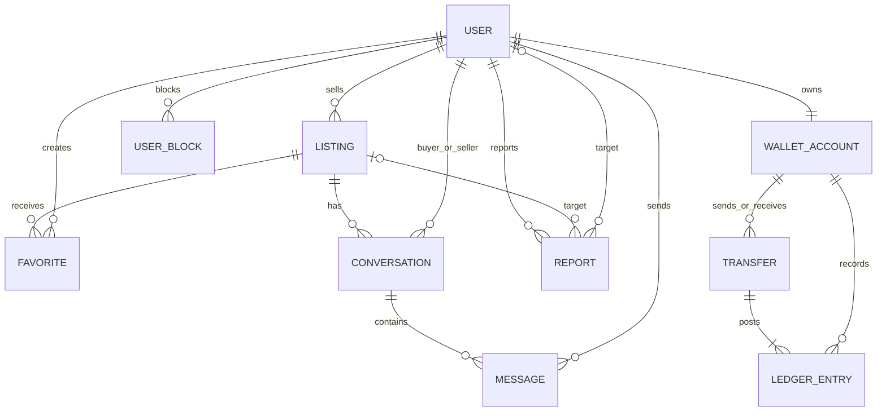
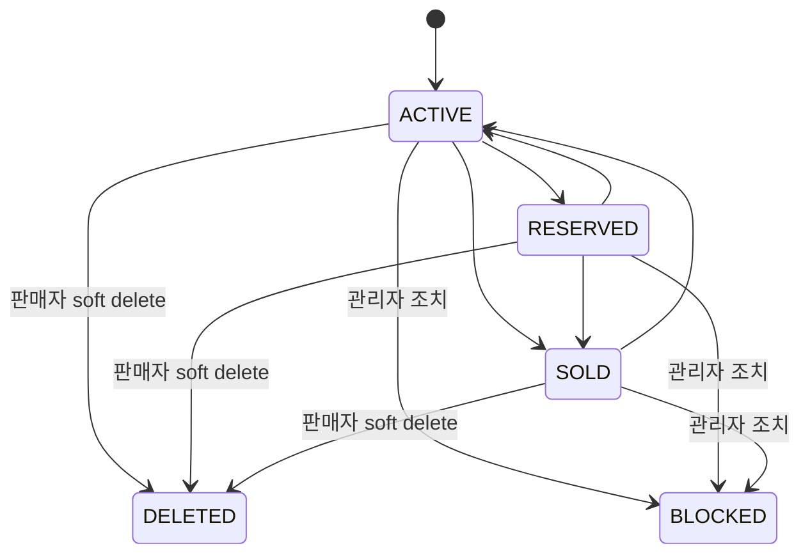

# TINY MARKET 개발 전 과정 및 시큐어코딩 보고서

> **제출용 통합 초안 — 개인정보·Public GitHub URL·원격 검사·최종 PDF 증적을 입력하기 전에는 제출하지 않는다.**
> 대괄호로 표시한 `[입력 필요: ...]`와 `[최종 확인 필요]`는 PDF 생성 전에 실제 증적으로 교체한다.

## 표지 정보

| 항목 | 내용 |
|---|---|
| 과제명 | Tiny Second-hand Shopping Platform |
| 프로젝트명 | TINY MARKET |
| 반 | `[입력 필요: XX반]` |
| 이름 | `[입력 필요: 이름]` |
| 전화번호 뒷자리 | `[입력 필요: 4자리]` |
| GitHub Public Repository | `[입력 필요: https://github.com/OWNER/REPOSITORY]` |
| 제출 대상 commit | `[입력 필요: 최종 commit SHA]` |
| release/tag | `[입력 필요: 예: v1.0.0]` |
| 공식 제출 기한 | **2026-07-24(금) 23:59:59** |
| 개인 작업 목표 | **2026-07-13까지 개발 결과와 보고서 초안 완성** |

최종 제출 파일명은 공백 없이 다음 형식을 사용한다.

```text
[WHS][secure-coding][XX반]이름(전화번호뒷자리).pdf
```

공식 제출 기한은 강의 슬라이드의 7월 23일 표기가 아니라 과제 공지에서 정정된 **2026년 7월 24일**이다. 7월 13일은 제출 기한이 아니라, 이틀로 압축한 개인 개발·문서화 목표일이다.

---

## 1. 요약

TINY MARKET은 Django 기반의 교육용 초소형 중고거래 플랫폼이다. 강의 PDF 35페이지의 최소 기능인 회원가입, 상품 등록·조회, 사용자 간 소통, 악성 사용자·상품 차단, 사용자 간 송금, 상품 검색, 관리자 관리를 모두 구현 대상으로 삼았다. 당근의 간단한 지역 거래·앱 내 대화·신고 경험과 번개장터의 전국 검색·세분 필터·거래 기록 장점을 선택적으로 결합했다.

보안은 기능 구현 뒤 덧붙이는 항목이 아니라 요구사항과 설계 단계부터 불변조건으로 정의했다. Django의 세션·CSRF·Form·ORM을 활용해 자체 인증·토큰 구현을 피했고, 객체 소유권·대화 참여자·관리자 세부 권한을 서버에서 다시 검사했다. 상품 이미지는 디코딩 후 메타데이터 없는 JPEG로 재인코딩하며, 송금 요구는 현금화할 수 없는 **DEMO POINT**와 원자적 이중 원장으로 제한했다.

보안 기준은 KISA 공식 게시물에서 확인한 **소프트웨어 개발보안 가이드(2021.12.29)**와 **Python 시큐어코딩 가이드(2023년 개정본)**이다. 사용자 요청의 “2026 시큐어코딩 가이드”라는 표현은 개발 기준연도를 뜻하는 것으로 해석하되, 존재를 확인하지 못한 2026 판본을 임의로 인용하지 않았다. 구현단계 7개 영역·49개 보안약점을 전수 판정했으며 현재 범위에서 37개는 적용, 12개는 기능·언어상 N/A로 분류했다. N/A도 단순 생략하지 않고 관련 기능과 위험 API가 없음을 확인하고, 향후 기능 추가 시 재평가하도록 했다.

마지막 보안 감사에서 인증 시도 동시성, 관리자 권한 상승, 신고 증거 변경, 관리자 이미지 처리 우회, 검증 전 자원 소모 같은 문제를 추가로 발견해 코드를 변경했다. 이후 2026-07-13 사용자 수동 QA에서 이미지 삭제 500과 DEBUG 기술 화면 정보노출을 추가 발견해 SEC-031·032 Open으로 등록했다. 아래 자동검사 수치는 이 두 항목 발견 전 스냅샷이므로 수정 후 전체 재실행 전에는 최종 결과로 사용하지 않는다.

- 최근 Django tests 스냅샷: **120개 전부 통과** - 단, `image-clear`·오류 본문 비노출 공백 확인
- 최근 Coverage: **3,169 statements / 223 miss / 93%**
- 최근 정적·의존성·배포 검사: **Ruff/Bandit 0건, pip-audit 0건, deploy check 0건, dev hash 설치 성공**

---

## 2. 개발 범위와 진행 방법

### 2.1 개발 원칙

이틀 일정에서 기능 수를 늘리기보다 다음 우선순위를 고정했다.

1. 강의 PDF의 필수 기능과 인수 조건을 먼저 확정한다.
2. 인증·인가·입력검증·데이터 무결성을 기능과 동시에 구현한다.
3. 정상 동작뿐 아니라 악성 입력, 위조 요청, 동시 요청, 실패 후 상태를 시험한다.
4. 실제로 발견한 보안약점만 원인·수정·재시험·잔여위험과 함께 기록한다.
5. 공개 저장소에 비밀정보·DB·업로드·개인정보가 들어가지 않도록 릴리스 단계에서 다시 검사한다.

이 원칙을 택한 이유는 짧은 일정에서 화려한 부가기능을 늘리면 검증하지 못한 공격면이 급격히 커지기 때문이다. 실제 결제, 배송, 지도, 소셜 로그인, 외부 이미지 URL, 실시간 WebSocket, 전화번호·정확한 주소 수집은 의도적으로 제외했다.

### 2.2 이틀 압축 일정

| 일자 | 단계 | 수행 내용 | 완료 기준 |
|---|---|---|---|
| 2026-07-12 | 요구사항 분석 | 첨부 PDF 34~36페이지 확인, 7개 필수 기능과 인수 조건 정의, 당근·번개장터 조사 | REQ-ID와 보안조건 연결 |
| 2026-07-12 | 시스템 설계 | Django 모놀리스, ERD, 권한표, 상태전이, 위협모델, KISA 적용성 판정 | 설계 결정과 선택 이유 기록 |
| 2026-07-12 | 구현 | 계정, 상품, 이미지, 대화, 신고·차단, DEMO POINT, Admin, 보안설정 구현 | 기능별 정상·실패·인가 테스트 작성 |
| 2026-07-12 | UI 재설계 | `#1E3A8A` 디자인 토큰, Flexbox·Grid, 반응형 header·card·button·form 구현 | 외부 UI 의존성 없이 접근성·CSP 유지 |
| 2026-07-13 | 모노크롬 UI 전환·체크리스트 축약 | 검정·흰색·중립 회색 UI, 원색 상품 사진, PDF 필수 18개 체크리스트 | 1440×1000·320×800 실측, 현재 코드 자동검사·실제 수행본 |
| 2026-07-12~13 | 검토·수정 | 병렬 코드리뷰, 브라우저 QA, 정적·의존성 검사, 발견 약점 수정 | 미조치 Critical/High 0건 목표 |
| 2026-07-13 | 최종 검증 | 전체 회귀, coverage, lint, Bandit, pip-audit, deploy check, 클린 설치 | 실제 명령 결과로 최종 수치 갱신 |
| 2026-07-13 | 릴리스·문서 | Public GitHub, README 재현, SHA/tag, 보고서 PDF 렌더링 | 로그아웃 공개 확인과 PDF 육안검수 |
| 2026-07-24 이전 | 제출 | 지정 파일명, PDF 링크·내용, 업로드 결과 재확인 | 23:59:59 전 제출 완료 |

---

## 3. 요구사항 분석

### 3.1 과제 필수 기능

| ID | PDF 요구사항 | 인수 조건 | 구현 요소 | 핵심 보안조건 |
|---|---|---|---|---|
| REQ-F001 | 사람들이 플랫폼에 가입 | 정상 가입·로그인·POST 로그아웃, 약한 비밀번호 거부 | `accounts.User`, 가입·로그인 view | 비밀번호 해시, 최소 12자, 역할 필드 미노출, 반복시도 제한, 세션 회전 |
| REQ-F002 | 상품 등록·조회 | 본인 상품 등록·수정·상태 변경·soft delete, 공개 상세 | `Listing`, 이미지 guarded endpoint | 판매자 서버 결정, IDOR 차단, 가격·상태 제약, 안전한 이미지 처리 |
| REQ-F003 | 사용자끼리 소통 | 상품별 판매자와 구매 희망자의 1:1 대화 | `Conversation`, `Message` | 참여자만 접근, 발신자 서버 결정, 차단 후 전송 금지 |
| REQ-F004 | 악성 사용자·상품 차단 | 대화 상대 차단·신고, 상품 신고, 관리자 조치 | `UserBlock`, `Report`, Admin action | 실제 대화에서 대상 파생, 신고 증거 불변, 대상 모델 권한 재검사 |
| REQ-F005 | 사용자 간 송금 | 잔액 범위 내 DEMO POINT 송금과 거래내역 | `WalletAccount`, `Transfer`, `LedgerEntry` | 원자적 조건부 차감, 멱등키, 이중 원장, append-only |
| REQ-F006 | 상품 검색 | 키워드·카테고리·상태·지역·정렬·페이지 | ORM 검색 view | 길이 상한, 정렬 허용목록, 차단·삭제·정지 판매자 상품 제외 |
| REQ-F007 | 관리자가 모든 요소 관리 | 권한 있는 staff의 조회·신고 처리·차단·정지 | Django Admin | 운영 기본 비활성, 세부 권한, 보호 계정, 원장 읽기 전용 |

### 3.2 문서·제출 요구사항

| ID | 요구사항 | 반영 위치 | 최종 확인 |
|---|---|---|---|
| REQ-D001 | 요구사항 분석부터 유지보수까지 전 과정 보고 | 본 문서와 `docs/00~12` | `[최종 확인 필요]` |
| REQ-D002 | 발견한 보안약점과 변경 내용 설명 | 본 문서 9장, `docs/04_SECURITY_FINDINGS.md` | SEC-001~032 동기화; SEC-031·032 Open |
| REQ-D003 | GitHub Public 저장소 | 표지·15장 | `[공개 URL 입력 및 로그아웃 확인 필요]` |
| REQ-D004 | README 환경 설정·실행 방법 | `README.md` | `[클린 환경 재현 결과 입력 필요]` |
| REQ-D005 | AI 도구 적극 활용 | 본 문서 13장, `docs/05_AI_USAGE_LOG.md` | `[최종 AI 사용 건 갱신 필요]` |
| REQ-D006 | 지정 PDF 파일명과 기한 준수 | 표지·최종 체크리스트 | `[제출 직전 확인 필요]` |

### 3.3 비기능 요구사항

- **보안:** KISA 49개 항목 판정, 최소권한, fail-closed 운영설정, 공급망 무결성.
- **무결성:** 가격·상태·신고 대상·송금 발신자를 클라이언트가 결정하지 못하게 한다.
- **가용성:** 업로드·입력·페이지·계정별 콘텐츠·반복 요청에 상한을 둔다.
- **개인정보 최소화:** 사용자명과 비밀번호 외 전화번호·실명·정확한 위치·금융정보를 수집하지 않는다.
- **재현성:** Python·의존성 버전과 해시를 잠그고 README 명령만으로 설치할 수 있게 한다.
- **감사 가능성:** 신고 처리자·상태·시간과 DEMO POINT 원장을 남기고 사후 수정 경로를 제한한다.
- **접근성·반응형:** 명시적 label, 오류·도움말 ARIA 연결, 모바일에서도 로그아웃 등 안전 기능을 사용할 수 있게 한다.

### 3.4 의도적으로 제외한 범위

- 실제 원화 결제, 카드·은행계좌, 충전·출금·환전, PG·웹훅·에스크로
- 배송사·지도·GPS 동네인증, 전화번호·실명 인증
- 외부 URL 이미지 가져오기, 소셜 로그인, 푸시 알림
- 실시간 WebSocket 채팅, AI 가격추천·정품검수·사기판정
- 별도 주문의 구매요청·승인·거절·취소·환불 상태 머신

이 제외는 최소 요구사항을 축소하기 위한 것이 아니라 검증할 수 없는 외부 비밀키, SSRF, 웹훅 위조, 개인정보, 금융규제, 환불 상태 경쟁조건을 현재 버전에 추가하지 않기 위한 보안 결정이다. 상품의 `ACTIVE/RESERVED/SOLD` 상태 전이는 구현했지만 별도 주문·환불 시스템을 구현했다고 주장하지 않는다.

---

## 4. 당근·번개장터 분석과 제품 반영

### 4.1 비교 결과

| 관점 | 당근의 장점 | 번개장터의 장점 | 구조적 단점·주의점 | TINY MARKET 결정 |
|---|---|---|---|---|
| 탐색 | 지역 중심의 간단한 발견 | 전국 단위 카테고리·상세 검색 | 지역만 쓰면 희귀 상품 범위가 좁고, 전국 거래는 비대면 위험이 커짐 | 지역은 선택 텍스트 필터로 제공하고 전체 검색도 허용 |
| 신뢰 | 동네인증·매너 단서·앱 내 대화 | 후기·안전결제·이상거래 탐지·검수 | 평판·인증도 계정 탈취와 선입금 사기를 보증하지 못함 | 불투명 점수 대신 권한, 상태, 신고 증거, 원장 같은 설명 가능한 통제 우선 |
| 소통 | 연락처 노출을 줄이는 앱 내 채팅 | 상품 문의와 거래 흐름 연결 | 외부 메신저·피싱 링크 유도, 제3자 대화 열람 위험 | 상품별 1:1 대화, 참여자 접근통제, sender 서버 결정 |
| 결제 | 채팅 흐름 안 송금 | 에스크로로 선입금 위험 완화 | 수수료·정산 대기·환불 분쟁, 실제 금융정보 부담 | 현금화 불가 DEMO POINT, 수수료 0, 원자적 이중 원장 |
| 운영 | 신고·금지상품 탐지·분쟁조정 | 위해상품 차단·검수·제재 | 자동 필터만으로 금지 상품과 설명 불일치 해결 불가 | 개인 차단+신고+관리자 soft block+처리 상태 기록 결합 |

### 4.2 장점을 선택한 이유

당근에서 가져온 핵심은 “등록과 대화의 마찰이 낮다”는 점이다. 제목, 설명, 가격, 상태, 카테고리, 지역, 선택 이미지로 상품을 등록하고 같은 서비스 안에서 대화하도록 해 연락처 노출을 줄였다. 번개장터에서는 전국 검색에 적합한 카테고리·상태·지역·정렬 필터와 거래 기록의 추적성을 가져왔다.

두 서비스의 기능을 그대로 복제하지 않은 이유는 과제 범위와 보안 보증이 다르기 때문이다. 동네인증이나 안전결제라는 표현은 실제 전화번호·위치 검증과 금융 인프라가 없으면 오해를 만든다. 따라서 지역은 “사용자가 입력한 검색 단서”일 뿐 인증된 위치라고 표시하지 않고, 포인트는 실제 돈이 아니라는 경고를 README와 화면에 반복 표시했다.

### 4.3 단점 보완 방식

- 평판 숫자가 안전을 보장하는 것처럼 보이지 않도록 매너점수 알고리즘을 제외했다.
- 순차 사용자 ID로 아무나 신고·차단하지 못하게 실제 참여 대화에서 상대를 서버가 파생한다.
- 차단·삭제 상품은 기존 대화에서도 제목·가격·이미지·등록시각을 다시 노출하지 않고 비공개 placeholder를 사용한다.
- 상품 설명과 실제 상태 차이는 자동 판정하지 않고 상태·하자 설명, 신고 증거, 관리자 처리 상태를 남긴다.
- 실제 안전결제의 효과를 흉내 내지 않고, DEMO POINT의 무결성과 중복 방지 범위만 명확히 보증한다.

조사 출처와 해석상 주의는 `docs/08_COMPETITOR_ANALYSIS.md`에 기록했다. 회사 자체 발표 수치는 독립 검증된 수치처럼 사용하지 않았고, 소비자원 자료는 특정 회사의 현재 피해율이 아니라 C2C 거래의 구조적 위험을 설명하는 데만 사용했다.

---

## 5. 시스템 설계

### 5.1 아키텍처 선택

REST API·SPA·JWT 대신 Django 서버 렌더링 모놀리스를 선택했다. 이틀 일정에서 브라우저 토큰 저장, CORS, 별도 API 권한 계층을 새로 만들지 않고 Django의 검증된 세션, CSRF middleware, Form, ORM, Admin을 일관되게 사용할 수 있기 때문이다.



현재 SQLite, LocMemCache, 로컬 파일 저장소는 단일 인스턴스 개발·검증용이다. 실제 운영 전에는 PostgreSQL, 모든 인스턴스가 공유하는 원자 Redis, WSGI 서버, TLS 프록시, 백업·모니터링으로 전환해야 한다.

### 5.2 모듈 구조

| 영역 | 책임 | 주요 파일 |
|---|---|---|
| `accounts` | 사용자, 가입·로그인·로그아웃, 정지, 사용자 차단, 로그인 시도 제한 | `models.py`, `forms.py`, `views.py`, `admin.py` |
| `market` | 상품·검색·이미지, 대화·메시지, 신고, 지갑·송금·원장 | `models.py`, `forms.py`, `views.py`, `services.py`, `admin.py` |
| `config` | 환경설정, URL, 오류 응답, 프록시 신뢰, 보안 헤더 | `settings.py`, `middleware.py`, `views.py` |
| `templates/static` | 서버 렌더링 UI, 접근성·반응형 CSS | `templates/`, `static/css/` |
| `.github` | CI, CodeQL, Dependabot | workflow와 설정 파일 |
| `docs` | 요구사항·결정·발견 약점·AI·테스트·KISA 증적 | `docs/00~12` |

UI는 새 Tailwind 대신 기존 semantic HTML, CSS Custom Properties, Flexbox와 Grid를 사용했다. 로컬 Tailwind CLI/PostCSS는 Node 빌드·lock·CI 감사 범위를 늘리고, Play CDN은 외부 script와 CSP 예외를 요구하므로 현재 일정에는 둘 다 채택하지 않았다. 초기 감청색 설계 뒤 사용자 요청으로 현재 UI chrome을 검정·흰색·중립 회색으로 전환했다. 검정 hero·primary button, 흰색 header·card·form, 중립 border·shadow로 정보 위계를 단순화했다. 단, 상품 색상은 구매 판단 정보이므로 업로드 사진은 원색을 유지하고 오류·성공 상태색은 안전 의미 전달 범위에서 유지한다. 상품 Grid는 데스크톱 4열에서 900px 3열, 700px 2열, 470px 1열로 바뀌며 주요 form·detail·wallet·chat은 700px 이하에서 1열이 된다.

### 5.3 데이터 모델



`LoginAttempt`는 계정·네트워크 제한 상태를 저장하지만 User 외래키나 원문 사용자명·IP를 저장하지 않고 HMAC 식별자만 보관하므로 ERD의 사용자 관계선에서 의도적으로 제외했다.

핵심 DB 불변조건은 다음과 같다.

- 사용자명은 소문자 정규화 후 대소문자 무관 유일하다.
- 정지 사용자는 동시에 활성 상태일 수 없다.
- 자기 자신 차단·대화, 동일 사용자 차단 중복을 허용하지 않는다.
- 상품 가격은 1~10,000,000 범위다.
- 신고 대상은 사용자와 상품 중 정확히 하나다.
- 사용자 지갑은 사용자당 하나이며 발행 지갑과 구분된다.
- 송금 계정은 서로 달라야 하고 멱등키 조합은 유일하다.
- 한 송금의 같은 계정 분개 중복을 막고 0 delta를 허용하지 않는다.

“한 송금에 정확히 두 분개이며 합계가 0”이라는 다중 행 조건은 이식 가능한 단일 CHECK로 표현하기 어렵다. 따라서 원자적 게시 service를 유일한 생성 경계로 두고, 운영 시 reconciliation이 분개 수·합계·지갑 cache를 독립 검증하도록 설계했다.

### 5.4 권한 매트릭스

| 기능 | 비회원 | 일반 사용자 | 소유자/참여자 | 권한 있는 staff | superuser |
|---|:---:|:---:|:---:|:---:|:---:|
| 공개 상품 검색·상세 | 허용 | 허용 | 허용 | 허용 | 허용 |
| 상품 등록 | 거부 | 허용 | 허용 | 일반 사용자 규칙 | 허용 |
| 상품 수정·삭제·상태 | 거부 | 타인 상품 거부 | 판매자만 허용 | Admin의 별도 제한 | 허용 |
| 대화 열람·메시지 | 거부 | 무관 대화 거부 | 구매자·판매자만 허용 | 참가자가 아니면 거부 | 참가자가 아니면 거부 |
| 사용자 신고·차단 | 거부 | 실제 대화 상대만 | 허용 | 동일 규칙 | 동일 규칙 |
| 비공개 상품 열람 | 거부 | 거부 | 판매자만 제한 허용 | `market.view_listing` 필요 | 허용 |
| 신고 처리 | 거부 | 거부 | 거부 | `market.change_report` 필요 | 허용 |
| 상품 차단 action | 거부 | 거부 | 거부 | 위 권한 + `market.block_listing` | 허용 |
| 사용자 정지 action | 거부 | 거부 | 거부 | 위 권한 + `accounts.suspend_user` | 허용 |
| 상품 영구 삭제 | 거부 | 거부 | 거부 | `market.delete_listing` + `market.purge_listing` | 허용 |
| 원장 수정·삭제 | 거부 | 거부 | 거부 | 거부 | ORM 경로에서도 거부 |

관리자 화면에서 action을 숨기는 것만으로는 권한통제가 되지 않는다. 공격자가 action 이름을 직접 POST할 수 있으므로 실행 함수 내부에서 대상 모델 권한을 다시 검사한다. 일반 `change_user` 권한과 계정 정지 권한을 분리해 제한된 운영자가 staff·superuser·그룹·권한 또는 정지 상태를 직접 편집하지 못하게 했다.

### 5.5 상품 상태 전이



수정·삭제 때 DB에서 현재 행을 다시 읽고 소유자와 최신 상태를 검사해, 사용자가 편집 화면을 연 뒤 관리자가 차단한 상품을 오래된 POST가 되살리지 못하게 했다. SQLite의 `select_for_update()` 한계 때문에 실제 다중 사용자 운영 전 PostgreSQL에서 경쟁 부하 시험을 다시 해야 한다.

### 5.6 위협 모델과 신뢰경계

보호할 자산은 비밀번호 해시·세션, 사용자·상품·대화·신고, 관리자 권한, DEMO POINT 잔액·원장, `SECRET_KEY`와 배포설정이다. 주요 공격자는 익명 자동화 공격자, 인증된 악성 사용자, 과도한 권한을 가진 staff, 위조 전달 헤더를 보내는 직접 연결자, 취약·변조 의존성으로 가정했다.

주요 위협과 설계 통제는 다음과 같다.

- IDOR·Mass Assignment → UUID와 서버 세션·URL 문맥, 객체 소유자·참여자 재검사, Form 허용목록
- SQLi·XSS·CSRF → ORM, autoescape, `safe` 금지, CSRF middleware, 상태 변경 POST
- 파일 위장·메타데이터·폭탄 → 크기·픽셀·프레임·실제 형식 확인 후 JPEG 재인코딩
- brute force·자원 고갈 → 계정+네트워크 인증 제한, 기능별 rate/quota, 입력 길이·페이지 상한
- 이중 지출·중복 송금 → 조건부 debit, transaction, 멱등키, 이중 원장
- 관리자 권한 상승 → 전용 권한, 보호 계정, action 내부 재검사, 증거 필드 readonly
- 프록시 헤더 위조 → 직접 peer가 신뢰 IP일 때만 XFF/XFP 사용, 잘못된 운영설정은 시작 거부
- 공급망 변조 → 버전·SHA-256 해시 lock, 최소권한·SHA pin CI, CodeQL, Dependabot

---

## 6. 구현 내용과 선택 이유

### 6.1 회원가입·인증

사용자명은 Unicode 정규화·공백 제거·소문자 저장을 하고 DB에서 대소문자 무관 유일성을 보장한다. 공개 가입 Form은 사용자명과 비밀번호만 받으며 `is_staff`, `is_superuser`, 그룹, 권한, 정지 상태를 받지 않는다. 비밀번호는 Django 표준 hasher와 검증기를 사용하고 최소 12자, 흔한 비밀번호, 숫자 전용, 사용자명 유사성을 검사한다.

일반 로그인과 Admin 로그인은 계정 HMAC과 네트워크 HMAC 범위를 함께 사용한다. 계정별 5회/15분, 네트워크별 원시도 30회/15분이며, 성공 시 해당 account 상태만 지우고 network 누적은 유지한다. 비밀번호 해시 전에 짧은 cache·DB 예약만 수행하고 hash 중에는 transaction이나 행 잠금을 유지하지 않는다. 계정 존재 여부와 무관하게 입력 사용자명의 ACCOUNT HMAC을 동일한 DB 경로로 처리하며, network 30회 상한으로 IP당 15분 window의 신규 ACCOUNT 행을 최대 30개로 제한한다. 만료 후 30분이 지난 행은 정리한다. 사용자명 150자·비밀번호 256자 상한도 고비용 인증 전에 검사하고 오류는 계정 존재 여부를 구분하지 않는다.

계정별 제한은 알려진 계정에 대한 표적 잠금 DoS 가능성과 brute force 방어 사이의 절충이다. 운영에서는 공유 Redis, 프록시·WAF 제한, 관리자 MFA와 위험 기반 지연을 함께 적용해야 한다.

### 6.2 상품·검색·이미지

판매자는 요청의 `seller` 필드를 신뢰하지 않고 로그인 세션에서 결정한다. 가격·제목·설명·지역 길이를 Form과 DB 제약으로 확인하고, 검색 정렬값은 허용목록에서만 선택한다. 공개 queryset은 `BLOCKED`, `DELETED`, 정지·비활성 판매자의 상품을 제외한다.

이미지는 JPEG·PNG·WebP만 허용하며 최대 5MB, 1,200만 픽셀, 단일 프레임을 적용한다. 확장자나 `Content-Type`만 믿지 않고 Pillow로 실제 바이트를 디코딩·검증한다. EXIF 방향을 반영한 뒤 메타데이터 없는 RGB JPEG로 다시 인코딩하고 UUID 파일명을 부여한다. 미디어 디렉터리를 정적 공개하지 않고 인가된 view만 `image/jpeg`, `nosniff`, `private, no-store`로 응답한다. 교체·삭제는 transaction commit과 파일 생명주기를 맞추고 실패한 새 파일을 정리하되 신고 snapshot이 참조한 파일은 private storage에 보존한다. 익명 공개 HTML을 포함한 모든 동적 응답도 `private, no-store`·`Pragma: no-cache`로 보내 차단 전 metadata의 브라우저·공유 proxy cache 재노출을 막는다.

운영 reverse proxy/Nginx가 `MEDIA_ROOT` 또는 `/_private-media/`를 정적 alias로 직접 서빙하면 guarded endpoint와 신고 증거 비공개를 우회한다. 따라서 두 경로를 절대 외부에 직접 노출하지 않고 모든 이미지 요청을 Django의 권한검사 이미지 view로만 통과시킨다.

공개 view뿐 아니라 Django Admin의 상품 Form도 같은 이미지 sanitizer를 사용한다. Admin을 별도 우회 업로드 경로로 남기지 않았고, 상품 추가를 비활성화하며 판매자·상태·차단 메타데이터는 action 또는 제한된 경로로만 변경한다. Admin 변경 직전 현재 Listing 행을 잠가 다시 읽고, 이미 purge된 상품의 stale 객체를 저장해 레코드를 되살리는 요청은 거부한다.

### 6.3 대화·차단·신고

한 상품에서 구매자와 판매자의 대화는 한 개만 생성되며, 제3자는 UUID를 알아도 접근할 수 없다. 발신자는 POST 값이 아니라 세션 사용자이고 차단 관계가 생기면 새 메시지와 송금을 막는다. 대화 목록은 30개씩 페이지네이션하고 마지막 메시지를 Subquery annotation으로 조회해 N+1 쿼리를 줄였다.

사용자 신고와 차단은 순차 사용자 ID를 신뢰하지 않고, 사용자가 실제 참여한 대화에서 상대방을 서버가 계산한다. 상품 신고는 현재 공개 가능한 상품 문맥에서만 허용한다. 신고 대상은 사용자·상품 중 정확히 하나여야 하며 중복·일일 생성도 제한한다.

상품 신고 transaction은 상품 행을 잠그고 신고 시점의 제목·설명·가격·분류·상태·이미지 저장명과 SHA-256을 Report snapshot에 고정한다. 이미지 저장명에는 참조 조회용 DB index를 둔다. snapshot이 참조한 이미지는 교체·soft delete·Admin purge 뒤에도 공개 route 없는 private storage에 남겨 판매자 글을 동결하지 않으면서 원 증거를 보존한다. 보존 이미지 Admin endpoint는 `view_report` 권한을 재검사하고 매 요청 SHA-256을 상수시간 비교한다. 누락·과대·변조 파일은 404로 거부하고, 정상 응답은 `private, no-store`·`nosniff`이며 actor/report 열람 로그를 남긴다.

신고 원문은 분쟁·감사 증거이므로 Admin에서 reporter, 대상, category, details, 상태·처리자·시각을 직접 편집하거나 추가·삭제할 수 없게 했다. 상태 변경과 차단·정지는 권한을 재검사하는 action으로만 수행한다. staff·superuser도 대화 상대에 의해 신고될 수 있어 증거는 보존하되, 자동·일괄 정지 action은 자신·staff·superuser를 건너뛴다.

### 6.4 DEMO POINT 송금

가입 시 100,000P를 발행하지만 실제 화폐·예금·전자지급수단이 아니다. 충전·출금·환전·현금화·구매자 보호를 제공하지 않으며 금융정보를 받지 않는다.

송금은 다음 순서로 하나의 transaction에서 수행한다.

1. 송신·수신 사용자의 현재 활성 상태와 차단 관계를 다시 확인한다.
2. 같은 사용자의 멱등키가 이미 있으면 완전히 같은 요청만 기존 결과로 반환한다.
3. `balance >= amount` 조건부 UPDATE가 정확히 한 행을 차감했는지 확인한다.
4. 수신 지갑을 가산하고 Transfer를 기록한다.
5. 송신 음수·수신 양수 LedgerEntry 두 건을 만들고 합계 0을 확인한다.
6. 중간 실패 시 전체를 rollback한다.

`Transfer`와 `LedgerEntry`는 게시 후 instance `save/delete`, QuerySet `update/delete/bulk_update`, upsert형 bulk operation을 모델 계층에서 거부한다. 정정은 기존 행을 덮어쓰는 대신 향후 별도 반전 거래로 표현한다. 단, DB 관리자 직접 SQL은 ORM 통제를 우회하므로 운영 DB 최소권한과 독립 감사가 필요하다.

### 6.5 관리자와 운영설정

운영(`DEBUG=false`)에서는 Admin URL을 기본 비활성화하고 명시적 환경변수로만 활성화한다. 신고 상태 변경, 상품 차단, 사용자 정지를 `change_report`, `block_listing`, `suspend_user`로 분리하고 상품 영구 삭제는 `delete_listing`과 `purge_listing`을 모두 요구한다. 신고 처리·차단·정지 action은 선택한 Report 행을 transaction에서 잠그고 `OPEN`을 다시 확인한 뒤 실행한다. 제한된 사용자 관리자는 일반 사용자 정보 일부를 볼 수 있어도 staff·superuser·그룹·권한·정지 상태를 forged POST로 변경할 수 없고, staff·superuser 대상 변경도 거부된다. 신고·메시지·대화·사용자 행동·로그인 시도·원장은 read-only evidence로 관리한다.

설정은 다음 조건에서 fail-closed로 시작을 거부한다.

- 운영에서 `DEBUG=true`
- 운영 `SECRET_KEY` 누락, 50자 미만, 낮은 문자 다양성 또는 알려진 비안전 prefix
- 운영 `ALLOWED_HOSTS` 누락 또는 wildcard
- 운영 HTTPS redirect 비활성
- HTTPS 프록시 모드인데 신뢰 프록시 IP가 없음
- boolean 환경변수에 지원하지 않는 값 입력

개발 SECRET_KEY는 커밋된 고정값 대신 프로세스 시작 때 임시 생성해 재사용 비밀 노출을 막는다. 그 결과 개발 서버 재시작 시 세션이 무효화되는 것은 의도한 동작이다. 운영에서는 1년 HSTS, Secure·HttpOnly·SameSite 쿠키, frame deny, `nosniff`, same-origin referrer, CSP와 Permissions-Policy를 적용한다. Admin 호환 때문에 Admin 경로 CSP에는 제한적 inline 예외가 있으며 잔여위험으로 관리한다.

---

## 7. KISA 시큐어코딩 기준 적용

### 7.1 기준 문서

- [KISA 소프트웨어 개발보안 가이드 게시물](https://www.kisa.or.kr/2060204/form?lang_type=KO&page=1&postSeq=5) — 확인 판본 2021.12.29
- [KISA Python 시큐어코딩 가이드 게시물](https://www.kisa.or.kr/2060204/form?lang_type=KO&menuSeq=4135&page=&postSeq=13) — 2023년 개정본
- [KISA 소프트웨어 보안약점 진단가이드 게시물](https://www.kisa.or.kr/2060204/form?lang_type=KO&page=1&postSeq=9)

### 7.2 49개 항목 판정 요약

| KISA 영역 | 전체 | 적용(A) | N/A | 주요 구현 증적 |
|---|---:|---:|---:|---|
| 입력데이터 검증 및 표현 | 17 | 10 | 7 | ORM, autoescape, CSRF, 이미지 재인코딩, 길이·가격·정렬 허용목록 |
| 보안기능 | 16 | 14 | 2 | 인증·인가, 비밀번호, 환경비밀, HTTPS·쿠키, 반복시도 제한, hash lock |
| 시간 및 상태 | 2 | 2 | 0 | 조건부 debit, 멱등성, stale 상품 재검사, pagination·quota |
| 에러처리 | 3 | 3 | 0 | 일반 오류화면, fail-closed, transaction rollback, 구체 예외 |
| 코드오류 | 5 | 3 | 2 | None 처리, 파일 자원 정리, 신뢰 불가 역직렬화 금지 |
| 캡슐화 | 4 | 4 | 0 | 세션별 데이터 경계, DEBUG/Admin 통제, 내부 상태 보호 |
| API 오용 | 2 | 1 | 1 | 위험 API 금지, 지원 버전·해시 lock, Bandit·pip-audit·CodeQL |
| **합계** | **49** | **37** | **12** | 상세 근거: `docs/07_KISA_BASELINE.md` |

N/A 예시는 XML·LDAP·전자서명·외부 TLS 요청·사용자 URL 서버 호출·자체 C 메모리 관리다. 현재 기능과 의존성이 없어 비적용이지만 `eval/exec`, shell, pickle, XML parser, `verify=False`, 외부 HTTP 호출 같은 금지 패턴을 검색해 기능 부재를 보조 확인한다. 향후 해당 기능을 추가하면 N/A를 자동으로 유지하지 않고 위협모델과 테스트를 다시 작성한다.

### 7.3 설계단계 적용

구현 체크리스트 외에도 설계 단계에서 입력·DB 조회·시스템 자원·웹 요청·HTTP·업로드 파일 검증, 인증·인가·비밀번호·반복시도, 중요정보 저장·전송, 예외·세션 통제를 산출물에 포함했다. 각 통제는 요구사항 ID, 구현 파일, 테스트 또는 수동 증적과 연결해 “가이드 준수”를 선언만 하지 않도록 했다.

---

## 8. 보안 구현의 핵심 불변조건

1. 요청이 보낸 `seller`, `sender`, `reporter`, 신고 사용자, 송금 발신자, 권한 필드는 신뢰하지 않는다.
2. 모든 객체 접근은 로그인 여부만이 아니라 소유자·대화 참여자·세부 권한을 다시 확인한다.
3. 상태 변경은 POST+CSRF이며 허용 상태 전이만 수행한다.
4. 보안·자원 제한은 가능한 한 고비용 Form 검증과 이미지 디코딩 전에 수행한다.
5. 가격·대상 XOR·정지/활성 관계·유일성은 Form뿐 아니라 DB 제약으로 중복 방어한다.
6. 비공개가 된 상품의 metadata와 이미지가 기존 URL·대화·cache로 다시 노출되지 않아야 한다.
7. 포인트 차감·가산·거래·분개는 전부 성공하거나 전부 실패해야 한다.
8. 게시된 거래·신고 증거는 일반 편집 화면으로 사후 변조할 수 없어야 한다.
9. 프록시 전달 헤더는 명시적으로 신뢰한 직접 peer에서만 사용한다.
10. 운영 필수 보안설정이 빠지면 경고만 하지 않고 시작을 거부한다.

---

## 9. 발견 보안약점과 변경 내역

다음 항목은 보고서 분량을 위해 의도적으로 삽입한 취약점이 아니라 요구사항 검토, 실패한 테스트, 수동 코드리뷰, 브라우저 QA, 정적·의존성 검사에서 실제로 발견한 문제다. 수정 전 코드는 최종 결과에 남기지 않고 원인, 변경 이유, 재현·회귀 증적으로 설명한다.

### 9.1 1차·2차 개발 중 발견 사항

| ID | 발견된 약점·영향 | 왜 변경했는가 | 어떻게 변경했는가 | 상태·증적 |
|---|---|---|---|---|
| SEC-001 | 신고 target을 모델 검증 전에 바인딩하지 않아 정상 신고 실패 및 대상 경계 혼동 | 클라이언트 대상 필드가 추가되면 임의 대상 지정으로 이어질 수 있음 | URL에서 조회한 정확히 한 대상을 `form.instance`에 먼저 바인딩, Form 대상 제외, DB XOR 유지 | 신고 대상·DB 제약 회귀 통과 |
| SEC-002 | 홈 템플릿의 미정의 GET 변수가 비회원 첫 화면 500 유발 | 누락 입력 하나로 가용성이 깨짐 | view에서 검증한 명시적 검색 context만 전달 | 빈 검색·익명 렌더링 회귀 통과 |
| SEC-003 | 운영 HSTS의 하위도메인·preload 정책 미적용 | 운영 HTTPS 정책이 부분 적용될 수 있음 | 1년 HSTS와 환경변수 제어, 운영 deploy check | 실제 도메인 준비 여부는 배포 전 확인 |
| SEC-004 | 설치 환경의 이전 `pip`에서 알려진 취약점 6건 | 런타임이 아니어도 공급망 설치 경로 자산임 | `pip` 26.1.2로 갱신 후 재감사 | 당시 재검사 0건; 제출 직전 재감사 필요 |
| SEC-005 | 모바일 CSS가 로그아웃 버튼을 숨김 | 공용 기기 사용자가 세션 종료를 찾기 어려움 | 숨김 규칙 제거, POST·CSRF 로그아웃 유지 | 브라우저 모바일 폭 확인; 최종 QA 반영 |
| SEC-006 | 송금 화면 지갑 context 누락으로 잔액 0 표시 | 서버 판단은 안전해도 사용자에게 잘못된 보안 상태 표시 | 인증 사용자 지갑을 view context에 전달 | 지갑 context 회귀 통과 |
| SEC-007 | 도움말·오류 ARIA ID 불일치 | 비밀번호 조건과 오류를 보조기술이 연결하지 못함 | Django 위젯 참조와 `_helptext`, `_error` ID 통일 | 템플릿·브라우저 확인 |
| SEC-008 | 신고 권한만으로 상품 차단·계정 정지 action을 호출할 수 있는 교차 모델 권한 상승 | action 숨김은 forged POST를 막지 못함 | 실행 시 `change_report`와 전용 `block_listing`/`suspend_user`를 각각 재검사, 보호 계정 제외 | 전용 권한·forged POST 회귀 통과 |
| SEC-009 | `/admin/login/`에 일반 로그인 제한을 우회하는 반복시도 경로 | 고가치 관리자 계정 brute force 가능 | Admin도 account 5회/network 30회 짧은 예약을 사용하고 성공 시 account만 clear | 일반·Admin 인증 회귀 통과 |
| SEC-010 | 정지 계정이 active로 남거나 기존 상품이 공개될 수 있음 | 정지의 보안 효과가 저장 경로에 따라 달라짐 | 모델 정규화+DB CHECK, 정지·비활성 판매자 공개 queryset 제외 | DB·공개범위 회귀 존재 |
| SEC-011 | 가입·상품·메시지·신고 생성 상한 부족 | DB·파일 저장소 고갈 DoS 가능 | 기능별 시간당/일일 rate, 활성·이력 quota, pagination | quota/rate·사전 gate 회귀 통과 |
| SEC-012 | 오래된 상품 수정 POST가 관리자 차단을 덮을 수 있고 임의 status 전이 가능 | TOCTOU와 상태 무결성 훼손 | transaction 안에서 최신 행·소유자·상태 재검사, 서버 전이 허용목록 | SQLite 동시성 한계는 잔여위험 |
| SEC-013 | 익명 동적 HTML·이미지 cache와 DB·파일 삭제 시점 불일치 | 차단·rollback·교체 후 metadata·파일 잔존 | 모든 동적 응답 `private, no-store`, evidence-aware commit 삭제, 실패 신규 파일 정리 | 익명 HTML·이미지·파일 수명주기 회귀 통과 |
| SEC-014 | XFF·XFP 신뢰경계가 불명확 | 헤더 위조로 네트워크 제한·HTTPS 판단 우회 가능 | 신뢰한 직접 프록시 IP에서만 전달 헤더 사용, 잘못된 프록시 설정 시작 거부 | 실제 프록시 overwrite 설정 필요 |
| SEC-015 | 순차 사용자 ID 신고·차단과 비공개 상품 metadata 재노출 | 계정 열거·무관 사용자 괴롭힘·moderation 우회 | 실제 대화에서 상대 파생, 공개 상품 신고만 허용, 비공개 placeholder | 대화 목록까지 후속 보강 |
| SEC-016 | 대화 목록 무제한 및 행별 마지막 메시지 N+1 | 사용자 데이터가 늘면 DB·HTML 자원 고갈 | 30개 pagination과 Subquery annotation | 운영 데이터 query plan 재측정 필요 |
| SEC-017 | Admin 밖 ORM에서 Transfer·LedgerEntry 수정·삭제 가능 | 감사 원장 사후 변조 가능 | append-only 모델·QuerySet, 정정은 별도 반전 원칙 | 직접 SQL은 최소권한·감사 필요 |
| SEC-018 | 버전만 고정하고 hash lock·지속 검사가 없음 | 패키지 아티팩트 치환과 main 보안회귀 탐지 부족 | SHA-256 runtime/dev lock, 최소권한·SHA pin CI, CodeQL, Dependabot | dev lock 빈 대상 hash 설치 성공; GitHub 최초 실행은 공개 후 확인 |

### 9.2 최종 보안 감사에서 추가 발견한 사항

아래 항목은 최종 보안 감사에서 발견·수정한 영역이며, 마지막 코드 기준 전체 테스트·coverage·정적 검사를 다시 실행해 검증했다.

| ID | 발견된 약점·공격 경로 | 변경 이유 | 적용한 수정 | 최종 검증 상태 |
|---|---|---|---|---|
| SEC-019 | `accounts.change_user`를 가진 제한 staff가 일반 사용자 편집 POST로 `is_staff`, `is_superuser`, 그룹·권한 또는 정지 상태를 바꿀 수 있음 | 계정 관리 권한이 관리자 권한 상승과 보호 계정 훼손으로 이어짐 | `accounts.suspend_user` 전용 권한 추가, 비-superuser의 특권·계정상태 필드 readonly, staff/superuser 변경 거부, self/bulk delete 보호 | 권한·password URL·forged POST 회귀 통과 |
| SEC-020 | 이미 로그인한 staff가 Admin login POST를 보내면 다른 계정의 성공으로 오판해 잠금 기록을 지울 수 있는 사전 인증 상태 혼동 | 기존 세션과 제출 계정을 분리하지 않으면 인증 감사 상태가 변조됨 | 로그인된 staff는 Admin index로 redirect, 로그인된 nonstaff는 403, 성공은 제출한 정규화 사용자명과 실제 인증 사용자까지 일치할 때만 인정 | staff/nonstaff 사전인증 회귀 통과 |
| SEC-021 | 비밀번호 해시 중 DB lock, 임의 이름별 행 증가, 과대 credential과 실제/미존재 분기 | SQLite 쓰기 잠금·DB 저장소 고갈·CPU DoS·계정 oracle 위험 | 짧은 예약, hash 중 lock 없음, 계정 5/network 30, 성공 account만 clear, 모든 ACCOUNT HMAC 동일 DB 경로, IP/window 신규 행 최대 30·30분 retention purge, 사전 길이 상한 | real/unknown·30회 경계·cleanup·oversized 회귀 통과 |
| SEC-022 | 상품 이미지·메시지·신고·송금 Form 검증 뒤 rate limit을 소비 | 공격자가 제한 카운터 전에 이미지 디코딩·긴 입력 검증 비용 반복 가능 | raw 길이·UUID 형식과 rate gate를 고비용 Form·이미지 처리 전에 배치하고 유효하지 않은 요청도 시도량에 포함 | sanitizer 미호출·429·잘못된 UUID 회귀 통과 |
| SEC-023 | `ReportAdmin` 일반 변경 화면으로 원문·대상·처리 metadata를 바꾸고 판매자 변경으로 원 상품 증거가 사라질 수 있음 | 신고 증거와 처리 감사기록의 무결성 훼손 | read-only, snapshot·SHA, 증거명 index·private 보존, `view_report` endpoint의 hash 재검증·no-store·nosniff·actor log | forged POST·보존·권한 열람·변조 거부 회귀 통과 |
| SEC-024 | Django Admin 상품 업로드가 sanitizer를 우회하고 purge된 stale 객체가 레코드를 되살릴 수 있음 | 위장 파일·moderation·삭제 무결성 우회 | 공용 sanitizer, Admin add 비활성, 제한 필드 readonly, 현재 행 잠금·부재 시 거부, evidence-aware 정리 | fake image·수명주기·stale resurrection 회귀 통과 |
| SEC-025 | 차단·삭제 상품의 대화 목록에서 등록시각 등 일부 metadata가 남음 | 제목·가격만 숨겨도 존재·활동 시점을 추론할 수 있음 | `listing_visible` 조건에서만 제목·상태·가격·이미지·등록시각 표시 | BLOCKED/DELETED 목록·상세 회귀 통과 |
| SEC-026 | staff·superuser가 상대방이면 신고 제출 자체를 거부 | 보호 계정 정지 방지와 증거 수집을 혼동해 내부자 신고 증거가 사라짐 | protected account 신고는 허용하되 suspension action만 자신·staff·superuser를 건너뜀 | 보호 계정 신고 OPEN·활성 유지 회귀 통과 |
| SEC-027 | CI 설치 대상과 개발 의존성 파일 이름·hash lock 정책이 불일치할 가능성 | 로컬과 CI 도구 버전 차이, hash 없는 설치 경로 발생 | `requirements-dev.in`과 `requirements-dev.lock`으로 일원화, CI는 `--require-hashes` dev lock 설치, deploy warning을 실패 처리 | 빈 대상 dev lock hash 설치 성공 |
| SEC-028 | 서버 작성·사용자 행동 모델을 generic Admin으로 변조하거나 일반 상품 권한만으로 차단·purge 가능 | 증거 무결성과 최소권한 훼손 | 관련 모델 read-only, 전용 조치 권한, Report action 행 잠금·OPEN 재검사 | forged evidence POST·전용 권한·action 잠금 회귀 통과 |
| SEC-029 | boolean 오타와 길이만 긴 저엔트로피 운영 SECRET_KEY 허용 | 잘못된 운영 구성을 안전하다고 오인 | strict boolean, key 50자·문자 다양성·비안전 prefix, HTTPS fail-closed | 격리 settings negative·정상 deploy 회귀 통과 |
| SEC-030 | 같은 reporter·대상의 병렬 요청이 중복 OPEN 신고 생성 가능 | 감사 처리 중복·자원 소모 | reporter 잠금과 대상별 조건부 UNIQUE, 충돌 일반화 | DB 제약·중복 웹 요청 회귀 통과 |

### 9.3 사용자 수동 QA에서 추가 발견한 Open 항목

| ID | 발견·재현 | 영향 | 현재 보완 | 제출 전 조치 |
|---|---|---|---|---|
| SEC-031 | 기존 상품 편집에서 `image-clear=on`을 제출하면 삭제 sentinel `False`를 파일 객체로 직접 대입해 `.name` AttributeError 500 | 상품 수정 가용성 저하, DEBUG 정보노출과 결합 | transaction rollback으로 기존 이미지·파일 손실 없음 | Django 필드 `save_form_data()` 정규화, 삭제·유지·교체·동시 선택·잘못된 파일·신고 증거 회귀 |
| SEC-032 | 기본 개발 실행의 처리되지 않은 400·404·500이 기술 오류 화면 사용 | traceback, 절대경로, 버전, 소스·로컬 변수, 요청·설정 정보 노출 가능 | production+DEBUG 기동 거부, DEBUG false 커스텀 오류 화면 비노출 확인 | 발표·배포 DEBUG false, 오류 본문·헤더 자동 테스트, standalone 500, 400·405·429 UX 검토 |

이 두 항목은 숨기거나 기존 120개 통과로 종결하지 않는다. 수정·신규 회귀·전체 재실행을 마친 뒤 상태와 수치를 갱신한다.

### 9.4 변경 후에도 남는 보안 한계

“보안약점이 없다”는 절대적 표현 대신, 확인된 위험을 수정하고 남은 위험을 운영 전제로 공개한다.

- 알려진 사용자명을 5회 틀리게 입력해 표적 계정 잠금을 유도할 수 있다. brute force 방어와의 절충이며 MFA·risk-based delay·관리자 별도 네트워크가 필요하다.
- LocMemCache와 SQLite는 다중 프로세스 전역 rate limit·강한 행 잠금을 제공하지 않는다.
- 직접 SQL, DB 관리자, 저장소 backup·CDN은 ORM·HTTP 삭제 통제를 우회할 수 있다.
- 대화는 참여자 접근통제만 하며 종단간 암호화가 아니다.
- 관리자 MFA, 관리 네트워크 제한, 중앙 SIEM·경보는 포함되지 않았다.
- 금지 상품·사기·정품 여부는 자동 판정하지 않고 관리자 수동 검토에 의존한다.

---

## 10. 테스트 계획·체크리스트와 결과

### 10.1 테스트 전략

기능별로 다음 네 층을 함께 검증한다.

1. **정상 흐름:** 가입, 등록, 검색, 대화, 신고, 송금, 관리자 처리.
2. **악성 입력:** SQLi·XSS 문자열, 과대 입력, 위장 이미지, 가격·상태·sender·seller·target 변조.
3. **인가 실패:** 비회원, 타인 상품, 비참여 대화, 무권한 staff, forged Admin POST.
4. **무결성·실패:** 중복 멱등키, 잔액 부족 rollback, stale update, 파일 저장 실패, 원장 변경·삭제 시도.

### 10.2 핵심 체크리스트

| 영역 | 확인 항목 | 기대 결과 |
|---|---|---|
| 인증 | 약한 비밀번호, 계정 존재 유무 오류, 반복시도, 과대 credential, Admin 우회 | 약한 값 거부, 공통 오류, 사전 제한, 기존 세션 혼동 없음 |
| 인가 | 타인 상품, 비참여 대화, 무권한 staff, action 직접 POST | 403/404 또는 안전한 거부, 상태 불변 |
| 입력·표현 | SQLi·XSS·CRLF·외부 next URL·정렬값·가격 경계 | 문자열 처리·escape·허용목록, 외부 redirect 없음 |
| CSRF·세션 | 상태 변경 GET, CSRF 누락, 로그인·로그아웃 세션 | POST 강제, 403, 로그인 회전·로그아웃 폐기 |
| 이미지 | MIME 위장, SVG/HTML, 5MB·12MP 초과, 애니메이션, EXIF | 업로드 거부 또는 안전한 JPEG 재인코딩 |
| 상품 | 판매자 변조, quota/rate, 상태 전이, 관리자 차단 후 stale POST | 서버 판매자, 제한 적용, 허용 전이만, 차단 유지 |
| 대화·신고 | sender 변조, 제3자 열람, 사용자 ID 열거, 비공개 metadata, 증거 변경·변조 파일·action 경합 | 실제 대화 대상, placeholder, read-only snapshot, SHA 재검증, 행 잠금 |
| 송금·원장 | 음수·초과·잔액 부족, 중복키, 차단 사용자, update/delete | 전체 rollback, 1회 반영, 전송 거부, append-only |
| 운영설정 | DEBUG, SECRET_KEY, hosts, HTTPS, proxy trust, Admin 노출, 익명 동적 cache | 잘못된 구성은 시작 거부, 모든 동적 응답 no-store |
| 공급망 | hash 설치, Ruff, Bandit, pip-audit, CodeQL, secret scan | 미조치 Critical/High 0건 목표 |

세부 자동 TEST-ID는 `docs/06_TEST_CHECKLIST.md`, 제출자 수동 인수·제출 점검은 `docs/10_USER_ACCEPTANCE_CHECKLIST.md`, 요구사항 연결은 `docs/02_REQUIREMENTS_TRACEABILITY.md`에 있다.

### 10.3 최근 자동검사 스냅샷 - SEC-031·032 수정 전

아래 값은 SEC-001~030 수정이 반영된 로컬 코드의 실제 결과다. 그러나 이후 사용자 QA에서 기존 테스트가 놓친 SEC-031·032를 발견했으므로 수정 후 전체 회귀·coverage·정적·의존성 검사를 다시 실행해야 한다. GitHub 원격 검사도 저장소 공개 전이므로 미실행 상태다.

| 검사 | 실행 명령·범위 | 스냅샷 실제 결과 | 증적 |
|---|---|---|---|
| Django system check | `python manage.py check` | 문제 0건 | 로컬 실행 결과 |
| Migration 일치 | `python manage.py makemigrations --check --dry-run` | 변경 없음 | 로컬 실행 결과 |
| Django tests | `python manage.py test` | **120개 전부 통과** | 로컬 실행 결과 |
| Coverage | `coverage run manage.py test` / `coverage report -m` | **TOTAL 3,169 statements / 223 miss / 93%** | 로컬 coverage 결과 |
| Coverage gate | CI 기준 85% 이상 | 로컬 93%로 기준 통과; 원격 미실행 | GitHub 공개 후 Actions URL 입력 |
| Ruff lint | `ruff check .` | 오류 0건 | 로컬 실행 결과 |
| Ruff format | `ruff format --check .` | 오류 0건 | 로컬 실행 결과 |
| Bandit | `bandit -c pyproject.toml -r accounts config market` | 이슈 0건 | 로컬 실행 결과 |
| Runtime pip-audit | `pip-audit -r requirements.lock --disable-pip` | 알려진 취약점 0건 | 로컬 실행 결과 |
| 운영 deploy check | 운영 환경변수로 `python manage.py check --deploy --fail-level WARNING` | 문제 0건 | 로컬 실행 결과 |
| 반응형 UI 구조 | CSS 중괄호·필수 breakpoint·외부 asset·template inline style/script 검사 | 중괄호 798/798, 1080/900/700/470/360px 규칙 존재, 외부 asset·inline style/script 0건 | 로컬 실행 결과와 TEST-R009 |
| Runtime hash 설치 | `pip install --require-hashes -r requirements.lock` | 빈 대상 설치 성공 | 로컬 설치 결과 |
| Dev hash 설치 | `pip install --require-hashes -r requirements-dev.lock` | 빈 대상 설치 성공 | 로컬 설치 결과 |
| 시크릿·금지 패턴 | 현재 파일+Git 이력, 위험 API·template escape 우회 검색 | 일치 0건 | 로컬 검색 결과 |
| GitHub CI·CodeQL | 첫 Public push의 Actions/Security | **미실행—Public push 후 확인** | `[입력 필요: URL·SHA]` |

### 10.4 브라우저 수동 QA

2026-07-12 브라우저 QA에서는 판매자 가입·로그인, 상품 등록·예약 상태 변경, 구매자 가입·로그인, 상품 상세·대화 시작·메시지, 대화 문맥 신고 화면, DEMO POINT 24,000P 송금과 잔액 100,000→76,000, 모바일 390px 로그아웃 노출을 확인했다. 폼 label을 한국어화한 뒤 재확인했고 브라우저 console 오류·경고가 없었다.

감청색 UI 적용 후 1440×1000에서 흰색 sticky header, blue gradient hero, 4열 상품 Grid, 카드 radius 20px와 shadow, 문서 가로 overflow 0을 다시 실측했다. 모바일 재접속은 브라우저 도구의 로컬 URL 보안 정책에 막혀 우회하지 않았고, 대신 1080/900/700/470/360px cascade를 독립 감사했다. 이 감사에서 901px 인증 header 경계, 35~40px 주요 보조 컨트롤, 긴 사용자 입력과 회원 nav overflow, sticky anchor 가림 가능성을 찾아 1080px 재선언, 주요 컨트롤 최소 44px target, `overflow-wrap`, 내부 nav scroll·fade, `scroll-margin-top`으로 수정했다. 실제 320px·200% 확대와 스크린리더 QA는 완료로 과장하지 않고 릴리스 전 항목으로 유지한다.

2026-07-13 모노크롬 전환 뒤 현재 브라우저에서 1440×1000 홈의 검정 hero·4열 Grid·가로 overflow 0과 320×800 홈의 1열 Grid·sticky header·44px primary button·가로 overflow 0을 확인했다. 로그인과 안전 가이드도 1440px에서 overflow 0, 외부 asset 0이었다. CSS 중괄호는 879/879이고 상품 이미지 computed `filter`는 `none`이었다. 실제 키보드 focus 이동은 브라우저 자동 제어에서 확인되지 않아 focus CSS 구현만 정적 검토하고 최종 사용자 확인 대상으로 남겼다.

2026-07-13 사용자 QA에서는 기존 이미지 삭제 선택 시 SEC-031 500을 재현했다. DEBUG true 응답은 약 91KB의 기술 화면으로 예외명과 traceback을 포함했고, DEBUG false의 동일 500은 TINY MARKET 일반 오류 화면이며 `AttributeError`·`Traceback`이 없었다. DEBUG true 404는 기술 URL 화면, DEBUG false 404와 CSRF 403은 커스텀 일반 화면이었다. 이 결과는 자동 테스트가 통과해도 사용자가 실제 분기를 확인해야 함을 보여 주며, 수정 전 제출 blocker로 유지한다.

최종 보안 감사 후 변경된 일반·Admin 로그인 제한, 성공 시 account-only clear, 제한 staff의 forged POST 거부, rate limit 시 이미지 decoder 미호출, 차단 상품 metadata 비공개는 자동 회귀로 재검증했다. 모바일 320px·200% 확대, 키보드·실제 스크린리더·색 대비 수동 QA는 PDF 제출 전 확인 대상으로 남는다.

---

## 11. 공급망·CI와 릴리스 설계

직접 의존성은 `.in` 파일, 재현 가능한 설치 산출물은 SHA-256 해시를 포함한 `.lock` 파일로 구분했다.

- `requirements.in` → `requirements.lock`: Django·Pillow 런타임
- `requirements-dev.in` → `requirements-dev.lock`: runtime + Ruff·Bandit·Coverage·pip-audit·pip-tools
- CI는 `--require-hashes`로 개발 lock 하나를 설치한다.
- 외부 GitHub Action은 이동 가능한 tag가 아니라 검토한 commit SHA로 고정한다.
- CI 기본 권한은 `contents: read`, CodeQL에 필요한 범위만 `security-events: write`로 제한한다.
- push/PR에서 migration·deploy check·Ruff·Bandit·coverage gate·pip-audit를 실행하고, CodeQL과 Dependabot은 주기 실행한다.

로컬 파일이 존재하는 것만으로 원격 검증 성공을 주장하지 않는다. Public 저장소 첫 push 뒤 실제 Actions·CodeQL 결과 URL과 대상 SHA를 이 보고서에 기록한다.

---

## 12. 유지보수 계획

### 12.1 변경 관리

1. 요구사항이 바뀌면 REQ-ID, 위협모델, KISA A/N/A 판정을 먼저 수정한다.
2. 기능 변경과 정상·악성·권한 회귀 테스트를 같은 PR에 포함한다.
3. DB 모델 변경은 migration과 rollback·데이터 전환 영향을 검토한다.
4. 의존성 변경은 lock diff, 공식 release note, pip-audit, 전체 테스트 후 병합한다.
5. 보안 수정은 SEC-ID로 원인·영향·수정·재시험·잔여위험을 남긴다.
6. 배포 전 `check --deploy`, 시크릿·Git 이력, backup 복구, HTTPS·HSTS를 확인한다.

### 12.2 정기 운영 작업

| 주기 | 작업 | 이유 |
|---|---|---|
| 매 PR | CI, CodeQL, 권한·입력·원장 회귀 | 보안 회귀의 main 유입 차단 |
| 매주 | Dependabot·pip-audit 검토 | 새 의존성 취약점 조기 발견 |
| 매일/실시간 | 로그인 제한, 403/429/5xx, Admin action·증거 열람/무결성 실패 보안로그 감시 | brute force·권한 오용·증거 변조·가용성 이상 탐지 |
| 매일 | DB·미디어 암호화 backup 및 복구 샘플 확인 | 장애·랜섬웨어·오삭제 대응 |
| 매일 | 원장 reconciliation: 분개 2건, 합계 0, 지갑 cache 일치 | 직접 SQL·코드결함 탐지 |
| 매주 | DB 참조 없는 orphan 이미지, 신고 증거 저장명 index·보존기한 점검 | rollback·스토리지 장애 후 잔존 파일 정리와 증거 조회 성능 유지 |
| 분기 | 관리자 권한·그룹·휴면 계정 검토, 키 교체 절차 연습 | 권한 누적·계정 탈취 영향 축소 |
| 릴리스 전 | 클린 설치, Public 접근, PDF·README 링크 검수 | 제출·배포 재현성 보장 |

### 12.3 운영 전 필수 전환

- SQLite → PostgreSQL 및 실제 동시성·deadlock·isolation 부하 시험
- LocMemCache → 공유 원자 Redis와 cache 장애 시 fail-closed 정책
- `runserver` → 지원 WSGI/ASGI 서버, TLS reverse proxy, 전달 헤더 overwrite
- reverse proxy/Nginx의 `MEDIA_ROOT`·`/_private-media/` 정적 alias 직접 노출 금지와 Django 권한검사 이미지 view 경유 검증
- 관리자 MFA·관리 네트워크 제한·별도 고권한 계정
- 중앙 로그·경보·감사 보존, 개인정보 보존·삭제 정책
- backup 암호화·복구 목표(RPO/RTO)와 정기 복구훈련
- 사용자 신고 처리 SLA, 금지상품 정책, 이의제기·분쟁 절차

### 12.4 보안 제보·사고 대응

공개 GitHub Issue에는 비밀번호, 세션, 토큰, 개인정보, 미수정 공격 코드를 올리지 않도록 `SECURITY.md`에 안내했다. GitHub Private vulnerability reporting을 사용하고, 접수 후 영향 commit·권한 전제·기밀성/무결성/가용성 영향·임시완화·수정·재검증·공개 여부를 기록한다. 비밀 노출 사고는 Git 삭제만으로 끝내지 않고 키 폐기·교체와 전체 이력 검사를 수행한다.

---

## 13. AI 도구 활용과 사람의 검증

OpenAI Codex와 병렬 검토 에이전트를 요구사항 분석, 공식 자료 확인, 경쟁사 조사, 설계 대안 비교, 코드 구현, 위협모델, 테스트 생성, 보안 감사, 문서 통합에 적극 사용했다. AI를 사용한 목적은 작업을 대신 증명하게 하는 것이 아니라 짧은 기간에 독립적인 검토 관점을 늘리고 반복 검사를 자동화하는 것이었다.

| 활용 단계 | AI가 제안·수행한 일 | 그대로 믿지 않은 이유 | 사람·도구의 검증 |
|---|---|---|---|
| 요구사항 | PDF 페이지 추출, 7개 기능 REQ-ID 분해 | 페이지·기한 오독 가능 | 원본 PDF 35~36페이지 육안 대조, 사용자 정정 공지 우선 |
| KISA 조사 | 가이드 판본·49개 항목 분류 | 존재하지 않는 최신 판본을 만들어낼 수 있음 | KISA 공식 게시물·PDF 표지·목차 직접 확인 |
| 경쟁사 | 당근·번개장터 장단점·적용안 | 회사 홍보 수치와 독립 자료 혼동 가능 | 공식 서비스·보도자료와 소비자원 자료 구분·교차검토 |
| 설계 | Django/SPA, SQLite/PostgreSQL, DEMO POINT 대안 | 과제 범위·로컬 환경을 모를 수 있음 | PDF 요구, 도구 상태, 공격면·검증시간으로 ADR 결정 |
| 구현 | 계정·상품·대화·원장·Admin 초안 | AI 코드는 권한·경쟁조건을 빠뜨릴 수 있음 | 코드리뷰, DB 제약, 정상+악성+forged POST 테스트 |
| 보안 감사 | Admin 권한상승, 로그인 동시성, 증거 변경, rate 순서 발견 | 제안 수정도 새 DoS·lock 문제를 만들 수 있음 | 수정안 재검토, 짧은 예약·전용 권한·사전 gate로 재설계 |
| 자동검사 | Ruff·Bandit·pip-audit·coverage 해석 | 도구 0건이 취약점 0건을 뜻하지 않음 | 수동 위협모델·브라우저 QA·잔여위험 병행 |
| UI 재설계 | 감청색 토큰·Grid/Flex override와 경계 폭 감사 | AI가 cascade·한글/사용자 입력 폭·실제 접근성을 오판할 수 있음 | 1440×1000 실측, 독립 정적 감사, 전체 회귀와 제출 전 실제 모바일 QA |
| 모노크롬 전환 | 검정·흰색 토큰, 기존 hard-coded 색상 감사, 18개 핵심 체크리스트 | 전역 grayscale가 상품 사진을 왜곡하거나 흑백 focus가 배경에서 사라질 수 있음 | 원색 상품 사진, 이중 focus ring, 1440·320px·로그인·안전 페이지 실측, 자동검사 재실행 |
| 보고서 | 문서 초안과 추적표 통합 | GitHub URL·원격 검사 성공을 추정할 수 있음 | 로컬 수치는 실제 결과만 기록하고 Public URL·Actions·PDF 외부 상태만 placeholder 유지 |

AI 프롬프트에는 실제 비밀번호, 토큰, 세션 쿠키, 비밀키, 개인정보를 넣지 않았다. 제안된 기능이 과제 최소 요구에 없거나 보안 검증 범위를 지나치게 늘리면 채택하지 않았다. 예를 들어 React+REST+JWT, 실제 결제·외부 이미지 URL, 구현하지 않은 주문 상태 머신을 완료로 표현하는 안을 거절했다.

최종 AI 활용 건수와 프롬프트·채택/수정/거절 기록은 `docs/05_AI_USAGE_LOG.md`를 기준으로 PDF 생성 직전에 갱신한다.

---

## 14. 잔여 위험과 한계

| 위험 | 현재 영향 | 현재 보완 | 향후 조치 |
|---|---|---|---|
| SQLite 동시성 | 다중 사용자 쓰기 잠금·row lock 한계 | 조건부 UPDATE, 짧은 transaction, DB 제약 | PostgreSQL 부하·경쟁 시험 |
| LocMemCache | 인스턴스별 rate counter 분리 | 단일 프로세스 교육 범위 명시, DB 인증 lock 보조 | 공유 Redis·장애정책 |
| 표적 계정 lockout | 알려진 계정에 일시 가용성 저하 | 네트워크 원시도 제한, 공통 메시지, 로그 | MFA, risk scoring, progressive delay |
| 관리자 계정 | MFA·관리망 미구현 | 운영 Admin 기본 비활성, 세부 권한·로그 | MFA/IdP, VPN·IP allowlist |
| Admin CSP inline 예외 | XSS 방어 강도 일부 저하 | 일반 사용자 경로는 엄격 CSP, Admin 접근 제한 | nonce/hash 기반 정적 자산화 검토 |
| 대화 기밀성 | 서버·DB 관리자는 내용 접근 가능 | 참여자 객체 접근통제, HTTPS | 암호화 at rest, 보존기간, 필요 시 E2EE 별도 설계 |
| 수동 moderation | 신고 처리 지연·판정 오류 | 신고 상태·처리자 기록, 상품 soft block·계정 정지 | 정책·SLA·이의제기·자동탐지 보조 |
| 파일 삭제 | backup·스토리지 장애에 orphan 가능 | commit 후 삭제, no-store, 정기 점검 계획 | object lifecycle·backup 보존 정책 |
| 원장 직접 SQL | ORM append-only 우회 | 서비스 단일 게시 경계, reconciliation 계획 | DB 최소권한·감사 trigger/외부 원장 |
| 실제 거래 보호 부재 | 배송·환불·사기 피해를 해결하지 않음 | DEMO POINT·교육용 경고, 금융정보 미수집 | 실제 서비스 확장 시 별도 규제·에스크로 설계 |
| 공개 CI 외부 상태 | 로컬 구성만으로 성공 보장 불가 | workflow·SHA pin·최소권한 구성 | 첫 push 후 Actions/CodeQL URL·SHA 증적 |

본 프로젝트는 교육용 결과물이며, 이 잔여 위험을 해결하지 않은 채 실제 금융·상거래 서비스로 운영해서는 안 된다.

---

## 15. GitHub 공개·README·제출 계획

### 15.1 공개 저장소 정보

- Public Repository: **[입력 필요: GitHub URL]**
- 최종 branch: **[입력 필요: main 등]**
- 최종 commit SHA: **[입력 필요]**
- release/tag: **[입력 필요]**
- GitHub Actions 결과: **[입력 필요: URL]**
- CodeQL 결과: **[입력 필요: URL]**
- 로그아웃 상태 공개 접근 확인시각: **[입력 필요: KST]**

### 15.2 README 재현 확인

README에는 Python 3.12 가상환경 생성, hash-locked 개발 의존성 설치, migration, 개발 서버 실행, 관리자 생성, 환경변수, 테스트·보안검사 명령, 운영 fail-closed 조건, 알려진 제약을 작성했다. 다음은 새 디렉터리·새 가상환경에서 README만 보고 재현한 뒤 기록한다.

- `[완료]` 빈 대상 디렉터리에 `requirements-dev.lock` hash 설치 성공
- `[최종 확인 필요]` migration과 서버 시작 성공
- `[최종 확인 필요]` 전체 테스트와 보안 검사 성공
- `[최종 확인 필요]` 비밀값·DB·업로드 없이 clone 가능
- `[완료]` README와 `docs/00~12` strict UTF-8 decode 오류 0건, 로컬 Markdown 링크 오류 0건, stale 완료 표현·의존성 파일명·조치 권한 표현 점검

남은 작업에는 외부·개인 증적인 반·이름·전화번호, Public GitHub URL·SHA·tag, 원격 Actions/CodeQL, 최종 PDF 캡처·렌더링뿐 아니라 로컬 SEC-031·032 수정, 신규 회귀와 전체 자동검사 재실행도 포함된다. 과거 로컬 자동검사 수치는 실제 스냅샷으로 보존하되 최종 수치로 재사용하지 않는다.

### 15.3 공개 전 검사

- `.env`, `var/`, SQLite DB, 업로드, log, coverage 파일이 Git 추적 대상이 아닌지 확인
- 현재 파일과 전체 Git 이력에서 비밀·개인정보 검색
- 노출 흔적이 있으면 이력 수정만 하지 않고 키 폐기·교체
- lock 파일 diff와 `--require-hashes` 클린 설치 확인
- GitHub Actions·CodeQL·Dependabot 실제 실행 확인
- Public URL을 로그아웃·시크릿 브라우저에서 확인
- 보고서에 URL, tag, SHA, 검사시각 입력

### 15.4 PDF 제출 직전 검사

- 표지의 반·이름·전화번호 뒷자리·GitHub URL 입력
- 모든 `[입력 필요]`, `[최종 확인 필요]` placeholder 제거
- 표·코드·Mermaid 그림의 잘림, 한글 글꼴, 링크 클릭 확인
- GitHub URL을 PDF에서 직접 클릭하고 로그아웃 상태 접근 확인
- 파일명을 `[WHS][secure-coding][XX반]이름(뒷4자리).pdf`로 저장하고 공백 0개 확인
- 공식 기한 **2026-07-24 23:59:59** 이전 업로드 후 다시 내려받아 열기

---

## 16. 결론

TINY MARKET은 과제의 7개 필수 기능을 하나의 Django 애플리케이션으로 연결하면서, 중고거래에서 반복되는 수평 권한상승, 대상·발신자 변조, 저장형 XSS, 위험 파일, 신고 악용, 관리자 권한 오용, 이중 지출과 공급망 위험을 설계 단계부터 다뤘다. 당근의 낮은 사용 마찰과 번개장터의 전국 검색·거래 추적 장점을 가져오되, 실제로 제공하지 않는 위치 인증·안전결제·정품 보증을 과장하지 않았다.

개발 중 발견한 문제는 숨기지 않고 왜 위험했는지, 어떤 신뢰경계를 잘못 두었는지, 코드·DB·권한·테스트를 어떻게 바꿨는지 기록했다. 특히 최종 감사에서 제한 staff의 계정 권한상승, Admin 사전 인증 상태 혼동, 비밀번호 해시 중 DB lock, 신고 증거와 Admin 업로드 우회까지 추가로 찾아 수정했다.

최종 결론은 자동검사 숫자 하나가 아니라 요구사항→설계→구현→공격 테스트→수정→잔여위험→유지보수의 추적성이다. 이전 코드의 로컬 전체 회귀·coverage·정적·의존성·deploy·hash 설치 검증은 완료했지만 사용자 QA에서 SEC-031·032와 테스트 공백을 추가 발견했다. 두 항목 수정·전체 재검증, Public GitHub, 원격 Actions/CodeQL, 최종 PDF를 완료하기 전에는 제출본으로 확정하지 않는다. URL, SHA, 개인정보와 외부 증적을 입력하고 사용자 인수 체크리스트까지 완료한 뒤 최종 PDF로 확정한다.

---

## 부록 A. 요구사항-구현-증적 요약

| 요구사항 | 주요 구현 | 주요 보안 증적 | 현재 판정 |
|---|---|---|---|
| REQ-F001 가입·인증 | `accounts` User/Form/view/LoginAttempt | Mass Assignment, 약한 비밀번호, account 5/network 30, account-only clear, oversized, Admin pre-auth | 2026-07-12 스냅샷 통과 |
| REQ-F002 상품 | Listing/Form/view/private image | IDOR, 가격·상태, stale update, 이미지 위장·증거보존·Admin sanitizer | **SEC-031 Open, 최종 미통과** |
| REQ-F003 소통 | Conversation/Message | 참여자·sender, 차단, pagination·N+1, 비공개 metadata | 2026-07-12 스냅샷 통과 |
| REQ-F004 차단·신고 | UserBlock/Report/Admin | 대상 열거 거부, snapshot/SHA/read-only evidence, forged action, protected account | 2026-07-12 스냅샷 통과 |
| REQ-F005 송금 | Wallet/Transfer/Ledger service | 조건부 debit, rollback, 멱등, 이중 원장, append-only | 2026-07-12 스냅샷 통과 |
| REQ-F006 검색 | home ORM query/filter/sort/page | SQLi 문자열, 허용목록, 길이, 비공개 제외 | 2026-07-12 스냅샷 통과 |
| REQ-F007 관리자 | Django Admin·전용 login | `suspend_user`·`block_listing`·`delete_listing`+`purge_listing`, read-only evidence, Admin 기본 비활성 | 2026-07-12 스냅샷 통과 |

## 부록 B. 최종 검증 명령

Windows PowerShell 기준 예시는 다음과 같다.

```powershell
py -3.12 -m venv .venv
.\.venv\Scripts\Activate.ps1
python -m pip install --require-hashes -r requirements-dev.lock
python manage.py migrate
python manage.py check
python manage.py makemigrations --check --dry-run
python manage.py test
coverage erase
coverage run manage.py test
coverage report -m
ruff check .
ruff format --check .
bandit -c pyproject.toml -r accounts config market
pip-audit -r requirements.lock --disable-pip
```

운영 검사에는 재사용하지 않을 충분히 긴 시험용 `SECRET_KEY`, 실제 형식의 host·origin, `DEBUG=false`를 설정하고 다음을 실행한다.

```powershell
python manage.py check --deploy --fail-level WARNING
python manage.py collectstatic --noinput
```

## 부록 C. 산출물 목록

| 산출물 | 역할 |
|---|---|
| `README.md` | 환경설정·실행·검증·운영 전제 |
| `SECURITY.md` | 위협모델·보안통제·제보·잔여위험 |
| `CHANGELOG.md` | 기능·보안 변경 이력 |
| `docs/00_PROJECT_JOURNAL.md` | 시간순 개발일지와 이유 |
| `docs/01_TWO_DAY_PLAN.md` | 이틀 압축 계획·완료기준 |
| `docs/02_REQUIREMENTS_TRACEABILITY.md` | 요구사항-구현-테스트 추적 |
| `docs/03_DECISION_LOG.md` | 주요 아키텍처 의사결정 |
| `docs/04_SECURITY_FINDINGS.md` | 보안약점 원인·수정·재시험 |
| `docs/05_AI_USAGE_LOG.md` | AI 사용·채택/수정/거절·사람 검증 |
| `docs/06_TEST_CHECKLIST.md` | 기능·공격·릴리스 체크리스트 |
| `docs/07_KISA_BASELINE.md` | KISA 49개 적용성·증적 |
| `docs/08_COMPETITOR_ANALYSIS.md` | 당근·번개장터 조사와 적용 결정 |
| `docs/09_REPORT_DRAFT.md` | 최종 제출 보고서 통합 초안 |
| `docs/10_USER_ACCEPTANCE_CHECKLIST.md` | PDF 원문 기반 사용자 수동 인수·보안·제출 점검 |
| `docs/11_CORE_SUBMISSION_CHECKLIST.md` | 제출 필수 18개 핵심 체크리스트 |
| `docs/12_CORE_CHECKLIST_EXECUTED_2026-07-13.md` | 현재 코드에서 Codex가 직접 수행한 PASS·FAIL·BLOCKED 판정 |
| `.github/workflows/*.yml` | CI·CodeQL 지속 검증 |
| `requirements*.in/lock` | 직접 의존성과 hash-locked 설치 |

## 부록 D. 최종 증적 삽입 자리

1. `[삽입 필요]` PDF 35페이지의 7개 요구사항 캡처
2. `[삽입 필요]` 홈·검색 화면
3. `[삽입 필요]` 상품 등록·상세·상태 변경
4. `[삽입 필요]` 대화·신고·차단 흐름
5. `[삽입 필요]` DEMO POINT 지갑·송금·균형 원장 결과
6. `[삽입 필요]` 권한 분리된 Admin 화면
7. `[삽입 필요]` 최종 tests·coverage·Ruff·Bandit·pip-audit·deploy check 로그
8. `[삽입 필요]` Public GitHub와 성공한 Actions·CodeQL 화면(대상 SHA 포함)
9. `[삽입 필요]` 로그아웃 상태 Public 접근과 최종 PDF 파일명
